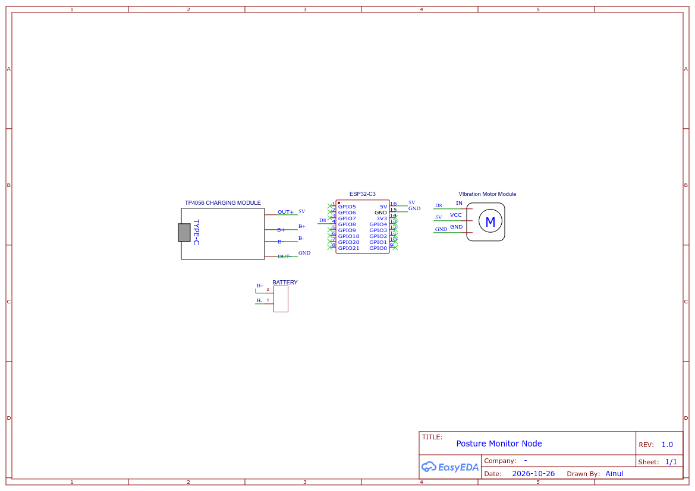

<p align="center">
  
</p>

<h1 align="center">Posture AI</h1>

<p align="center">
  <b>Sistem Pemantauan Postur Pintar Masa Nyata & Maklum Balas Haptik IoT Boleh Pakai</b>
</p>

<p align="center">
  <a href="posture-monitor/DOCKER_AND_SERVICES_MY.md"></a>
  <a href="posture-monitor/API_DOCUMENTATION_MY.md"></a>
  <a href="posture-monitor/SECURITY_AND_ARCHITECTURE_MY.md"></a>
  <a href="esp32/MQTT_SPECIFICATION_MY.md"></a>
  <a href="posture-monitor/DOCKER_AND_SERVICES_MY.md"></a>
  <a href="posture-monitor/SECURITY_AND_ARCHITECTURE_MY.md"></a>
</p>

> **Posture AI** ialah platform kesihatan ergonomik dan penjejakan biometrik masa nyata gred industri. Menggabungkan model penglihatan komputer **Google MediaPipe Pose** dengan peranti boleh pakai **Jam Haptik ESP32-C3**, sistem ini menganalisis postur duduk, mengesan badan membongkok, memantau masa sedentari (duduk terlalu lama), dan menguatkuasakan tabiat ergonomik melalui penggera audio pelayar web dan getaran fizikal.

---

## 📑 Pilihan Bahasa Dokumentasi
* 🇬🇧 **[English Documentation](README.md)**
* 🇲🇾 **[Dokumentasi Bahasa Melayu (Sedang Dipaparkan)](README_MY.md)**

---

## 🏛️ Gambaran Keseluruhan Seni Bina Sistem

```
+---------------------------------------------------------------------------------------------------+
|                                   TOPOLOGI SISTEM POSTURE AI                                      |
+---------------------------------------------------------------------------------------------------+

     [ KLIEN DESKTOP / WEBCAM ]                                       [ PELAYAN & ENJIN DOCKER ]
     Folder: posture-monitor/backend/static                           Folder: posture-monitor/

 +------------------------------------+                             +-----------------------------------+
 |       PELAYAR WEB DESKTOP          |                             |          POSTURE-MONITOR          |
 |  - Tema Apple Liquid Glass UI      |    Hantar Frame JPEG REST   |         CONTAINER (5000)          |
 |  - Tangkapan Video WebRTC Webcam   | ==========================> |  - Enjin Flask 3.0 + Gunicorn     |
 |  - Sekatan Automatik Telefon Bimbit|                             |  - Google MediaPipe Pose 0.10.14  |
 |  - Penggera Audio Web Audio API    | <========================== |  - Pengekstrak Ciri Biometrik     |
 |  - Sesi Selamat Cookie HttpOnly JWT|    Respons Telemetri JSON   |  - Kronometer Sedentari & Bongkok |
 +------------------------------------+                             |  - SQLite Auth + Sulitan Bcrypt   |
                                                                    +-----------------------------------+
                                                                                      |
     [ PERANTI HAPTIK BOLEH PAKAI ]                                                   | TCP Tempatan:1883
     Folder: esp32/                                                                   v
 +------------------------------------+                             +-----------------------------------+
 |         JAM WEARABLE ESP32-C3      |                             |        ECLIPSE MOSQUITTO          |
 |  - Mikropengawal RISC-V 160MHz     |    MQTT (Port 1888/1883)    |        BROKER MQTT (v2.0)         |
 |  - Portal Captive WiFiManager AP   | <========================== |  - Penghantaran Segera (QoS 0)    |
 |  - Pemacu Motor Gegar Transistor   |   posture/wearable/{MAC}/cmd|  - Port 1888 Pemetaan Hos Luar    |
 |  - Kitaran Nadi Getaran 400ms      |                             +-----------------------------------+
 |  - Had Kuasa RF Selamat (8.5 dBm)  |                                               |
 +------------------------------------+                                               v
                                                                    +-----------------------------------+
                                                                    |         RESEND EMAIL API          |
                                                                    |  - Kod OTP Kriptografi 6-Digit    |
                                                                    |  - Pengaktifan & Reset Password   |
                                                                    |  - posture@mail.flowkraft.xyz     |
                                                                    +-----------------------------------+
```

---

## 🔌 Litar Skematik & Sambungan Pinout Hardware

Peranti haptic wearable dikuasakan oleh **ESP32-C3 SuperMini** yang disambungkan ke litar pemacu motor getaran NPN dengan perlindungan diod flyback:

<p align="center">
  
</p>

### 📌 Jadual Sambungan Pinout Hardware
| Komponen | Pin ESP32-C3 | Fungsi | Spesifikasi Teknikal |
| :--- | :--- | :--- | :--- |
| **Motor Getar (+)** | `3.3V` / `VCC` | Bekalan Kuasa | 3.3V DC / Arus operasi ~70mA |
| **Tapak Transistor (B)** | `GPIO 8` | Isyarat Picu PWM | Dikawal melalui perintang siri $1\,\text{k}\Omega$ (`MOTOR_PIN`) |
| **Pengeluar Transistor (E)**| `GND` | Rujukan Ground | Rel bumi sepunya (*common ground*) |
| **Pemungut Transistor (C)**| Motor (-) | Suis Ground | Menyerap arus terminal negatif motor |
| **Diod Flyback (1N4001)** | Merentasi Motor | Perlindungan Arus Balik | Katod ke 3.3V, Anod ke Pemungut (C) |
| **LED Terbina Dalam** | `GPIO 8` | Penunjuk Visual | Berkelip serentak dengan denyutan motor getar |

* 📄 **Muat Turun Skematik PDF Boleh Cetak:** [`Schematic_posturemonitor_2026-10-26.pdf`](Schematic_posturemonitor_2026-10-26.pdf)
* 📄 **Panduan Sambungan Litar Terperinci:** [`esp32/PINOUT_AND_WIRING_MY.md`](esp32/PINOUT_AND_WIRING_MY.md)
* 📡 **Spesifikasi Protokol Telemetri MQTT:** [`esp32/MQTT_SPECIFICATION_MY.md`](esp32/MQTT_SPECIFICATION_MY.md)
* ⚡ **Panduan Flashing Firmware ESP32:** [`esp32/FLASHING_AND_SETUP_MY.md`](esp32/FLASHING_AND_SETUP_MY.md)

---

## 🌟 Ciri-ciri Utama & Algoritma Sistem

### 1. Pengesanan Berdiri vs. Duduk Kalis Jarak Kamera (*Proximity-Invariant*)
* Mengukur jarak Euclidean antara bahu kiri (`LEFT_SHOULDER`) dan kanan (`RIGHT_SHOULDER`).
* Mengira faktor skala dinamik:
  $$\text{Faktor Skala} = \frac{\text{Lebar Bahu Semasa}}{\text{Lebar Bahu Asas Kalibrasi}}$$
* Menyelaraskan garisan ambang berdiri (*standing threshold*) mengikut kedudukan pengguna dari kamera. Jika pengguna duduk dekat atau jauh dari webcam, sistem **tidak akan sesekali tersilap mengesan keadaan berdiri**.

### 2. Enjin Pengesanan Postur Teruk & Mekanisme Anti-Tipu (*Anti-Cheat*)
Berbeza dengan penjejak biasa yang hanya mengukur jarak leher, Posture AI menilai 5 vektor biometrik serentak:
1. **Badan Bongkok Ke Depan (*Slouching*):** Dikesan apabila $\text{Nisbah Leher} < 88\%$ daripada nilai tegak kalibrasi.
2. **Anti-Cheat 1 (Bahu Tenggelam):** Sekiranya pengguna melorot ke belakang kerusi dan mendongakkan kepala ke atas untuk menipu sistem, sistem akan mengesan **Kejatuhan Bahu** ($> +0.035$).
3. **Anti-Cheat 2 (Mendongak Berlebihan):** Mengesan dongakan dagu yang tidak wajar ($\text{Head Pitch} > +0.045$).
4. **Kepala Tertunduk:** Mengesan pandangan condong ke bawah atau bermain telefon ($\text{Head Pitch} < -0.065$).
5. **Badan Senget:** Mengesan kecondongan bahu kiri/kanan melepasi had ($> 10\%$).

### 3. Dua Mekanisme Amaran Serentak (*Dual Alert Engine*)
* **Had Sedentari (Duduk Terlalu Lama):** Memberi amaran apabila tempoh duduk melebihi had yang ditetapkan (cth: 10m, 20m, 30m, atau masa kustom). Pengguna **wajib berdiri sekurang-kurangnya 5 saat berturut-turut** untuk menetapkan semula pemasa duduk.
* **Postur Teruk Berterusan:** Jika postur dikesan teruk berterusan selama **$\ge 5$ saat**, penggera pelayar web dan getaran haptik ESP32 akan berbunyi dan bergetar serentak sehingga postur ditegakkan semula.
* **Operasi 100% Standalone:** Jika tiada ESP32 disambungkan, pelayar web tetap berfungsi sepenuhnya dengan amaran audio **Web Audio API** dan penunjuk visual.

### 4. Antara Muka Apple Liquid Glass & Sekatan Akses Telefon
* Dibina dengan `backdrop-filter: blur(45px) saturate(190%)` dan palet warna rasmi Radix Precision.
* **Sekatan Automatik Telefon Bimbit:** Sekiranya dibuka melalui telefon pintar, sistem secara automatik memaparkan skrin khas yang mengarahkan pengguna membuka sistem melalui komputer riba atau PC.
* **Tipografi Seragam:** Menggunakan font Google Font **Roboto** secara menyeluruh pada semua butang, suis, dan teks data.

### 5. Piawaian Keselamatan Perusahaan (SOP `DEVELOPMENT.md`)
* Pendaftaran dan log masuk dilindungi dengan enkripsi kata laluan **Bcrypt**.
* **Integrasi Resend Email API:** Kod OTP 6-digit dihantar daripada `posture@mail.flowkraft.xyz` untuk tujuan pengaktifan akaun dan tetapan semula kata laluan (*Forgot Password*).
* **Token Sesi Cookie HttpOnly JWT:** Menghalang serangan Cross-Site Scripting (XSS).
* Kunci akaun automatik selama 15 minit selepas 5 percubaan log masuk gagal.

---

## 📂 Struktur Direktori Repositori

```text
.
├── logo.svg                          # Logo Vektor Utama Projek
├── favicon.svg                       # Ikon Vektor Tab Pelayar Web
├── favicon.ico                       # Fail Ikon Pelbagai Resolusi (16x16 hingga 64x64)
├── schematic.svg                     # Litar Skematik Vektor Hardware
├── Schematic_posturemonitor_2026-10-26.png # Gambar Litar Skematik (PNG)
├── Schematic_posturemonitor_2026-10-26.pdf # Litar Skematik Boleh Cetak (PDF)
├── README.md                         # Dokumentasi Utama (Bahasa Inggeris)
├── README_MY.md                      # Dokumentasi Utama (Bahasa Melayu)
│
├── esp32/                            # Skop Peranti Boleh Pakai (Wearable)
│   ├── README.md                     # Ringkasan Hardware (Bahasa Inggeris)
│   ├── README_MY.md                  # Ringkasan Hardware (Bahasa Melayu)
│   ├── PINOUT_AND_WIRING_MY.md       # Panduan Sambungan Pinout & Breadboard
│   ├── MQTT_SPECIFICATION_MY.md      # Spesifikasi Topik & Arahan MQTT
│   ├── FLASHING_AND_SETUP_MY.md      # Panduan Persediaan Arduino IDE & Upload
│   └── use-for-production-12sept2026-332pm/
│       └── use-for-production-12sept2026-332pm.ino # Kod Sumber Firmware ESP32
│
└── posture-monitor/                  # Skop Pelayan Docker & Dashboard Web
    ├── README.md                     # Ringkasan Backend (Bahasa Inggeris)
    ├── README_MY.md                  # Ringkasan Backend (Bahasa Melayu)
    ├── API_DOCUMENTATION_MY.md       # Rujukan Lengkap Endpoint REST API
    ├── DOCKER_AND_SERVICES_MY.md     # Panduan Pengurusan Multi-Container Docker
    ├── SECURITY_AND_ARCHITECTURE_MY.md # Huraian Keselamatan & Algoritma AI
    ├── docker-compose.yml            # Konfigurasi Docker Compose (Flask + MQTT)
    ├── .env.example                  # Templat Pemboleh Ubah Persekitaran
    ├── mosquitto/                    # Konfigurasi Broker MQTT Mosquitto
    └── backend/                      # Teras Kod Python Flask
        ├── app.py                    # Pelayan REST API & Saluran Inferens
        ├── auth_db.py                # Pengurusan SQLite, Bcrypt & OTP
        ├── email_service.py          # Integrasi Resend Email API
        ├── requirements.txt          # Senarai Pakej Keperluan Python
        ├── Dockerfile                # Imej Kontena Pengeluaran
        └── static/                   # Fail Antara Muka Web (index, login, privacy, 404)
```

---

## 🚀 Panduan Pelancaran Pantas

### 1. Jalankan Pelayan Docker
```bash
cd posture-monitor/
cp .env.example .env
# Kemas kini nilai RESEND_API_KEY jika ingin menguji penghantaran emel sebenar

docker compose up -d --build
```
* **Papan Pemuka Web:** Buka `http://localhost:5000` (atau `http://<IP_KOMPUTER>:5000`)
* **Pemeriksaan Kesihatan (*Healthcheck*):** `http://localhost:5000/api/v1/health`
* **Port Broker MQTT:** Port luaran `1888` $\rightarrow$ port dalaman kontena `1883`.

### 2. Muat Naik Firmware ke Jam ESP32
1. Buka Arduino IDE dan pasang pakej papan `esp32 by Espressif Systems` (pilih papan **ESP32C3 Dev Module**).
2. Pasang pustaka tambahan: `PubSubClient` oleh Nick O'Leary dan `WiFiManager` oleh tzapu.
3. Buka fail `esp32/use-for-production-12sept2026-332pm/use-for-production-12sept2026-332pm.ino`.
4. Muat naik (*upload*) ke ESP32-C3.
5. Sambungkan telefon/laptop ke WiFi Access Point `Posture_Watch_XXXX` untuk menetapkan WiFi dan alamat IP broker MQTT.
6. Salin Alamat MAC yang tertera pada Serial Monitor dan tekan butang **Link** di laman web monitor!

---

## 📜 Lesen
* Dibangunkan untuk **Tujuan Pembelajaran Sahaja** (*Educational Purposes Only*).
